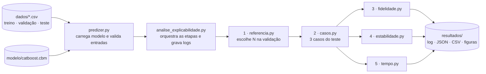

# Desafio 01: explicabilidade de um modelo de risco de crédito

## Visão geral

Um classificador CatBoost já treinado estima a probabilidade de inadimplência em 90 dias de solicitações de crédito
**sintéticas**. Este projeto **não treina um modelo novo**. Ele explica previsões individuais do modelo entregue e
testa se essas explicações são confiáveis:

1. **Método:** SHAP intervencional para árvores, calculado pelo próprio CatBoost, na escala de **log-odds**, com
   uma referência de 200 linhas do treino (tamanho escolhido na validação).
2. **Três casos** do teste, com risco baixo, intermediário e alto, explicados em linguagem simples.
3. **Fidelidade:** a explicação reconstrói a saída do modelo, e remover as features apontadas muda a previsão
   3 a 4 vezes mais do que remover features aleatórias.
4. **Estabilidade:** repetição, troca da amostra de referência e perturbações pequenas que respeitam o dicionário
   de dados.
5. **Tempo:** preparação e explicação por caso, com repetições.
6. **Crítica:** correlação entre variáveis, escolha da referência, fidelidade versus utilidade e ausência de causalidade.

📄 **Relatório com os resultados e a interpretação: [`01-explicabilidade/RELATORIO.md`](01-explicabilidade/RELATORIO.md)**

O enunciado original está em [`01-explicabilidade/README.md`](01-explicabilidade/README.md).

## Arquitetura



| Caminho | Responsabilidade |
| --- | --- |
| `01-explicabilidade/analise_explicabilidade.py` | Ponto de entrada. Roda as etapas em ordem, registra o progresso e salva as saídas. |
| `01-explicabilidade/explicabilidade/configuracao.py` | Todos os parâmetros e sementes, declarados antes de olhar o teste. Tem os modos completo e rápido. |
| `01-explicabilidade/explicabilidade/nucleo.py` | Classe `Explicador` (modelo + referência → log-odds e SHAP) e funções auxiliares. |
| `01-explicabilidade/explicabilidade/referencia.py` | Etapa 1: escolhe o tamanho da referência na validação, com uma regra declarada. |
| `01-explicabilidade/explicabilidade/casos.py` | Etapa 2: seleciona os casos pelos percentis 10/50/90 e descreve cada um. |
| `01-explicabilidade/explicabilidade/fidelidade.py` | Etapa 3: aditividade e teste de remoção top-k vs. aleatório. |
| `01-explicabilidade/explicabilidade/estabilidade.py` | Etapa 4: repetição, troca de referência e perturbações válidas. |
| `01-explicabilidade/explicabilidade/tempo.py` | Etapa 5: tempos de preparação e de explicação por caso. |
| `01-explicabilidade/explicabilidade/figuras.py` | Gráficos. |
| `01-explicabilidade/test_analise.py` | Testes rápidos da solução (aditividade, determinismo, restrições das perturbações etc.). |
| `predizer.py`, `gerar_dados.py`, `treinar_modelo.py`, `test_explicabilidade.py`, `dados/`, `modelo/` | Materiais originais do desafio, sem alterações. |

## Como executar

Requisito: [uv](https://docs.astral.sh/uv/getting-started/installation/). Ele instala o Python 3.12 e as versões
fixadas em `uv.lock`. Não há variáveis de ambiente nem chaves de API, e a solução não adiciona dependências.

```bash
git clone https://github.com/biaanuness/CloudWalk-Desafio-1.git
cd CloudWalk-Desafio-1
uv sync --frozen
```

Testes (materiais originais + solução, cerca de 1 s):

```bash
uv run --frozen python -m unittest discover -s 01-explicabilidade -p 'test_*.py' -v
```

**Docker (opcional):** `docker build -t desafio-explicabilidade .` e
`docker run --rm -v "$PWD/saida:/app/saida" desafio-explicabilidade`. Isso roda o modo rápido e grava as saídas em
`./saida`. O Dockerfile não foi testado de ponta a ponta no ambiente onde a solução foi desenvolvida, porque a rede
de lá bloqueia o download das imagens. O caminho validado é o `uv`.

## Guia de demonstração

**Demonstração rápida, cerca de 10 s.** Percorre o fluxo inteiro com amostras menores:

```bash
uv run --frozen python 01-explicabilidade/analise_explicabilidade.py --rapido
```

**Análise completa, cerca de 2 min em 4 CPUs.** Gera os números citados no relatório:

```bash
uv run --frozen python 01-explicabilidade/analise_explicabilidade.py
```

O terminal mostra cada etapa e os resultados intermediários: a tabela de escolha da referência, os três casos com
os principais fatores, a fidelidade para cada k, a estabilidade por caso e os tempos. O mesmo conteúdo fica em
`execucao.log`. Saídas em `01-explicabilidade/resultados/` (ou em `resultados_rapido/`):

| Arquivo | Conteúdo |
| --- | --- |
| `execucao.log` | Rastro da execução, com os resultados intermediários de cada etapa. |
| `resultados.json` | Todos os números: ambiente, parâmetros, casos, fidelidade, estabilidade e tempos. |
| `explicacoes_casos.csv` | Contribuição de cada uma das 19 features nos três casos. |
| `fidelidade_remocao.csv` | Cada teste de remoção: linha, k, tipo, mudança prevista e real. |
| `casos.png` | Gráfico das 5 maiores contribuições de cada caso. |
| `referencia_validacao.png` | Qualidade versus custo do tamanho da referência. |

**Reprodutibilidade.** Semente `20261117`, CatBoost com 2 threads. Duas execuções completas seguidas produziram
resultados idênticos, exceto os tempos. Casos escolhidos: `S0007173` (baixo), `S0016371` (intermediário) e
`S0005455` (alto).

> Observação: este README substitui o README curto original da raiz, cujo hash consta em `MANIFESTO.json`. Todos
> os demais arquivos listados no manifesto continuam idênticos.
